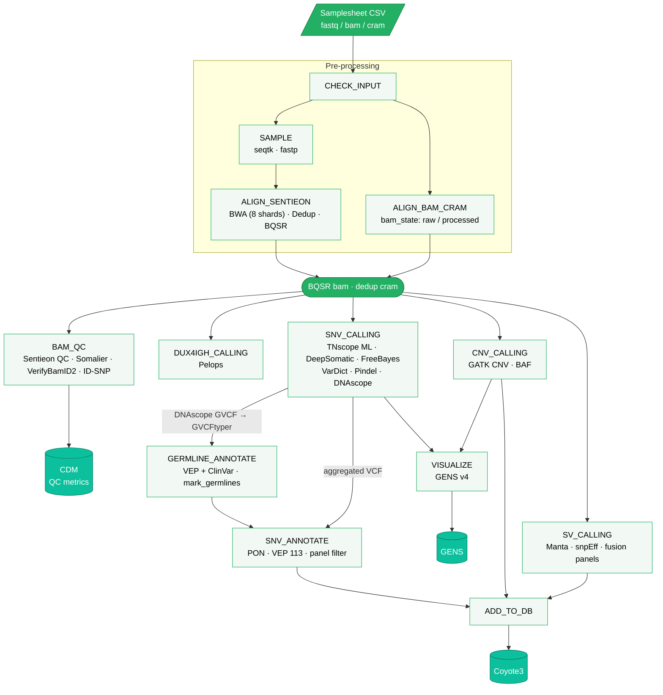

# SMD-Bioinformatics Lund – Somatic Whole Genome Sequencing (SWGS) Pipeline

This page describes how to run the Somatic Whole Genome Sequencing Pipeline (main.nf) on the SMD-Bioinformatics computing cluster (Hopper/Grace), as well as how the pipeline integrates with the automated infrastructure.

## Overview

The main entry point for the pipeline is:

```
main.nf
```

Before running the pipeline, make sure to update the Nextflow config (nextflow.config) to match the server environment and to choose the correct panel based on the biological question—e.g., hematology or solid tumor.

Our compute environments currently include the Hopper and Grace SLURM clusters.
A corresponding Nextflow profile (hopper) is available in the configuration file.

The elaborate technical documentation on the bioinformatics softwares used are described in the [documenation](./doc).

### Pipeline Overview



### Running the Pipeline Manually

#### 1. Hematology Pipeline

```bash
module load singularity Java nextflow/21.10.6

nextflow run main.nf \
    -entry SWGP \
    -c nextflow.config \
    --csv sample.csv \
    -profile hema \
    -with-report /path/to/workdir/nextflow/reports/sample.report.html \
    -with-trace /path/to/workdir/nextflow/reports/sample.trace.txt \
    -with-timeline /path/to/workdir/nextflow/reports/sample.timeline.html \
    -work-dir /path/to/workdir/nextflow_tmp
```

#### 2. Solid Tumor Pipeline

```bash
module load singularity Java nextflow/21.10.6

nextflow run main.nf \
    -entry SWGP \
    -c nextflow.config \
    --csv sample.csv \
    -profile solid \
    -with-report /path/to/workdir/nextflow/reports/sample.report.html \
    -with-trace /path/to/workdir/nextflow/reports/sample.trace.txt \
    -with-timeline /path/to/workdir/nextflow/reports/sample.timeline.html \
    -work-dir /path/to/workdir/nextflow_tmp
```

#### 3. Test / Local Minimal Profile

A lightweight test profile exists for local or simplified runs:

```bash
module load singularity Java nextflow/21.10.6

nextflow run main.nf \
    -entry SWGP \
    -c nextflow.config \
    -profile hopper \
    --csv sample.csv \
    -profile test \
    --dev \
    -with-report /path/to/workdir/nextflow/reports/sample.report.html \
    -with-trace /path/to/workdir/nextflow/reports/sample.trace.txt \
    -with-timeline /path/to/workdir/nextflow/reports/sample.timeline.html \
    -work-dir /path/to/workdir/nextflow_tmp
```

### Integration With SMD Automated Pipeline System

In production, pipeline execution is automated using the
bnf-infrastructure
repository.

Two key components handle this:

```
1. start_nextflow_analysis.pl
```

A Perl script that monitors and triggers pipeline runs based on the availability of CSV files from earlier `Bjorn` system

```
2. pipeline_files.config
```

Defines which pipeline, container, and server settings to use.

Example configuration:

```
[tumwgs-hema]
pipeline = /production_pipeline/nextflow_tumwgs/main.nf -entry SWGP --profile hema
container = /production_pipeline/nextflow_tumwgs/container/tumwgs_container.sif
singularity_version = 3.8.0
nextflow_version = 21.04.2
executor = slurm
cluster = grace
queue = normal

[tumwgs-solid]
pipeline = /production_pipeline/nextflow_tumwgs/main.nf -entry SWGP --profile solid
container = /production_pipeline/nextflow_tumwgs/container/tumwgs_container.sif
singularity_version = 3.8.0
nextflow_version = 21.04.2
executor = slurm
cluster = grace
queue = normal

```
